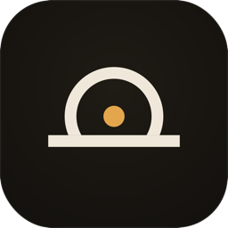
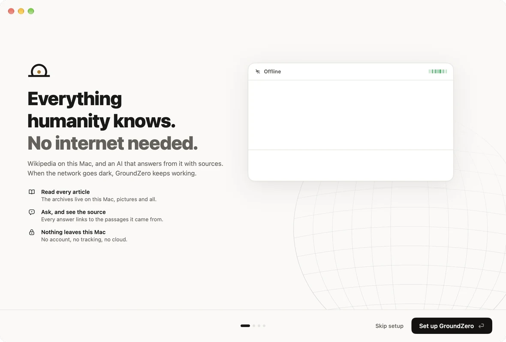
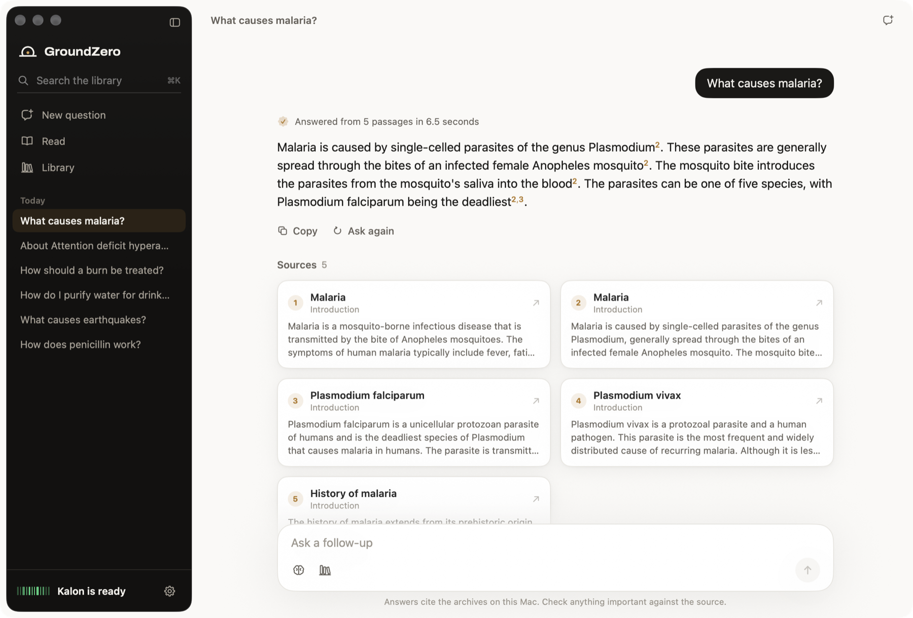
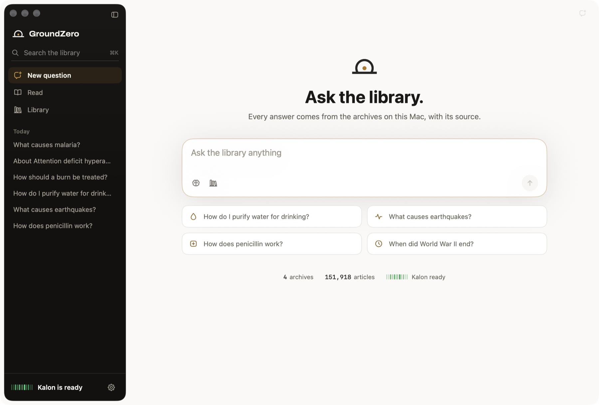
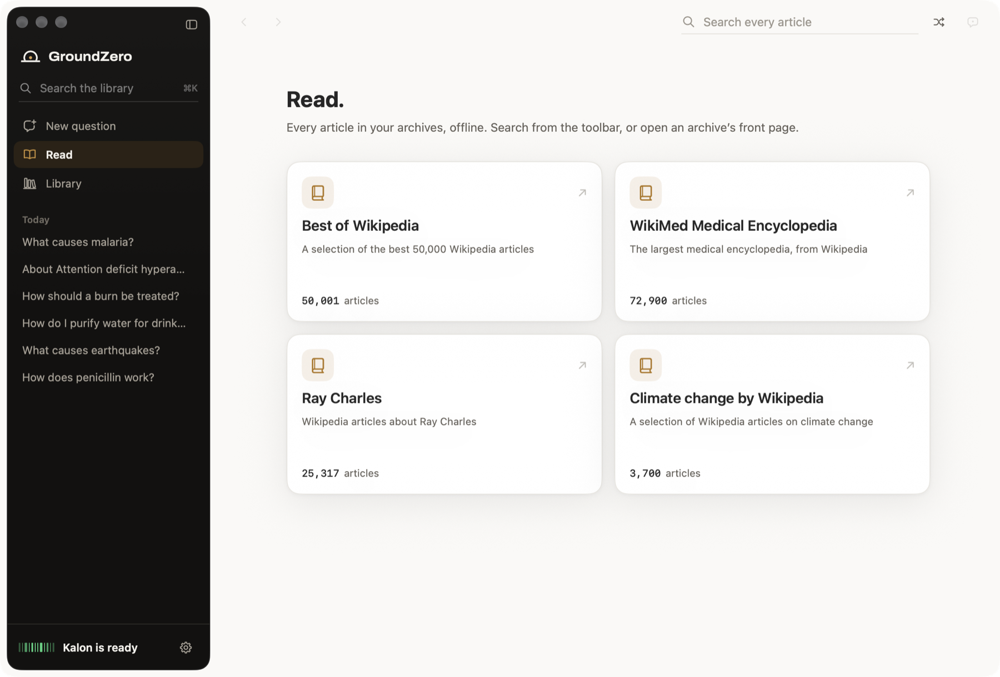

  

<h1 align="center">GroundZero</h1>

  <strong>Everything humanity knows. No internet needed.</strong>

  Wikipedia and a growing shelf of reference archives, kept on your Mac. 
  Search it in an instant, read it anywhere, and ask it questions.

  <a href="https://github.com/KalonEdge/groundzero/releases/latest/download/GroundZero.dmg"><strong>Download for Mac</strong></a>
  &nbsp;&nbsp;·&nbsp;&nbsp;
  <a href="https://github.com/KalonEdge/groundzero/releases">What's new</a>

  
  
  

 

  

 

When the network is down, the cable is cut or you are simply far from a signal, GroundZero still
works. Every article lives on your Mac. Search returns in an instant, articles open without a
connection, and questions are answered from the archives you keep, with every source shown.

## Ask

Ask in plain words, the way you would ask a person. The answer is written on your Mac from the
articles in your library, and small citation numbers open the exact passage each part came from. Conversations stay in the sidebar, so you can return to them, follow up, or ask again.

Answers are written by [Kalon](https://github.com/KalonEdge/kalon), which runs entirely on your Mac.
GroundZero can install Kalon for you on first launch. Reading and search work without it.

  

## Read

Every archive opens as a page of its own. Front pages are laid out as picture galleries, topic
pages become clean lists you can scan, and articles are set for long, comfortable reading in light
and dark, with the text size you prefer. Search finds any article across every archive at once.

  
  &nbsp;
  

## Build your library

Choose from the full Kiwix catalog of Wikipedia and other reference archives, by language and by
topic. Start with the essentials in under half a gigabyte, or keep all of English Wikipedia.
Downloads continue in the background, can be paused and resumed, and are checked against their
published checksums before they are opened. GroundZero then builds a search index for each archive,
on your Mac.

## Install

1. Download **[GroundZero.dmg](https://github.com/KalonEdge/groundzero/releases/latest/download/GroundZero.dmg)**.
2. Open it and drag **GroundZero** into **Applications**.
3. Open GroundZero. A short welcome sets up Kalon and your first archives.

GroundZero requires macOS 26 or later on a Mac with Apple silicon.

## Updates

GroundZero keeps itself up to date. It checks for a new version once a day and installs it when you
quit, and you can choose **GroundZero › Check for Updates…** at any time. Automatic updates can be
turned off in **Settings › General**.

## Privacy

GroundZero has no account and no analytics. Your questions, answers and reading stay on your Mac.
It goes online only to check for updates, to show the archive catalog when you browse it, and for
downloads you start.

## Security

Every release is signed with our Developer ID and notarized by Apple. Every update is checked
against its published size and SHA-256, and must carry our signature, before it is installed.
Please report security issues privately, as described in [SECURITY.md](SECURITY.md).

## Feedback

Found a problem or have an idea? [Open an issue](https://github.com/KalonEdge/groundzero/issues).

## Credits

Article text comes from Wikipedia, written by its contributors and shared under
[CC BY-SA 4.0](https://creativecommons.org/licenses/by-sa/4.0/). Archives are packaged by
[Kiwix](https://kiwix.org) and [openZIM](https://openzim.org). Full notices are in
[THIRD_PARTY_NOTICES.md](THIRD_PARTY_NOTICES.md).

 

© 2026 KalonEdge

